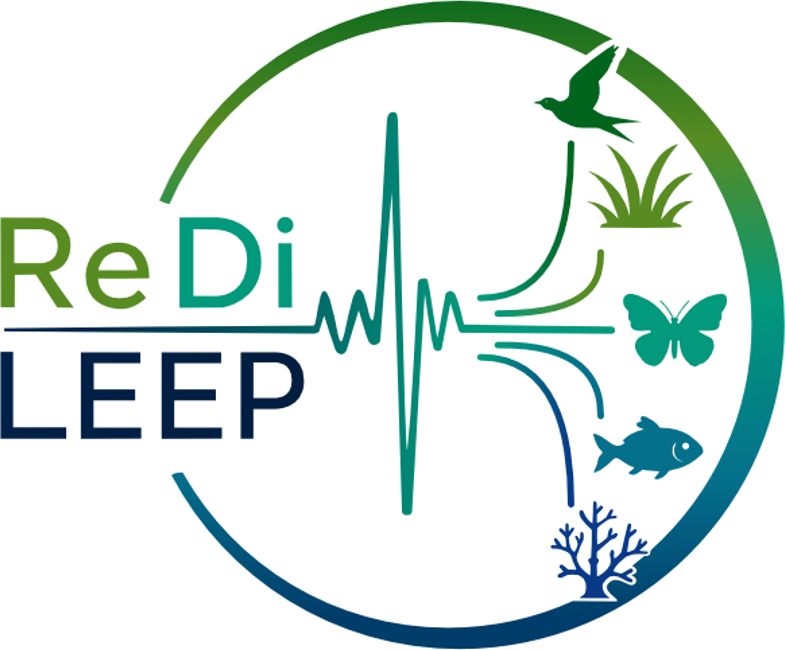

  <h2 class="person-name">Dr Samuel R.P-J. Ross</h2>
  He/Him

ロス・サムエル

<strong>Associate Professor</strong> | 特定准教授

<strong>Email:</strong> s.ross.res [at] outlook.com

**PhD** (Trinity College Dublin, Ireland)  
**MBiol, BSc** (University of Leeds, UK)

Hakubi Center for Advanced Research  
Graduate School of Agriculture (concurrent)  
**Kyoto University**

Kitashirakawa Oiwake-cho, Sakyo-ku, Kyoto, 606-8502 Japan

白眉センター  
農学研究科（兼任）  
**京都大学**

〒606-8502 京都市左京区北白川追分町  
農学部総合館 S-545号室（吉田キャンパス北部構内）

I’m interested in the abiotic and biotic drivers of ecological stability. Specifically, I develop concepts and methods for assessing the role of response diversity in driving stability, and I use ecoacoustic data to quantify ecosystem dynamics, change, and stability in real-world ecosystems. In my spare time, I enjoy reading, going to the cinema, drinking matcha lattes, and being Kyoto's least-requested DJ.

生態系の安定性・応答の多様性・音響モニタリング

<a href="https://scholar.google.co.uk/citations?user=R3aMfY0AAAAJ&hl=en"
   aria-label="Google Scholar"
   title="Google Scholar">
  <i class="bi bi-mortarboard-fill"></i>
</a>

<a href="https://github.com/SamRPJRoss"
   aria-label="GitHub"
   title="GitHub">
  <i class="bi bi-github"></i>
</a>

<a href="https://www.researchgate.net/profile/Samuel-Ross-4"
   aria-label="ResearchGate"
   title="ResearchGate">
  <i class="bi bi-person-lines-fill"></i>
</a>

  <h2 class="person-name">Nacho</h2>
  He/Him

ナチョちゃん

<strong>Research Support Staff</strong> | 研究支援者

Nacho provides essential support. His main research focus is prey capture rates, especially of toy mice and feathers on strings. He likes birdwatching and napping in the sun.

獲物捕獲・鳥類観察・昼寝

## Open positions

<!-- ======================================================
     RESEARCH ADMINISTRATIVE ASSISTANT
     ====================================================== -->

  JOIN US
  事務補佐員

  <h2 class="person-name">研究事務補佐員</h2>

Research Administrative Assistant

<strong>事務補佐員</strong> | 京都大学大学院農学研究科

<strong>研究課題：</strong> JST創発的研究支援事業「音響解析による生態系レジリエンス解明」  
<strong>所属：</strong> 京都大学大学院農学研究科 森林科学専攻 京都　　
<strong>採用時期：</strong> 2026年12月1日以降、できるだけ早い時期  
<strong>勤務時間：</strong> 週1日7時間（応相談）  
<strong>給与：</strong> 時間給 1,200円  
<strong>応募締切：</strong> 2026年10月31日 17:00（適任者が見つかり次第締切）

JST創発的研究支援事業「音響解析による生態系レジリエンス解明」を中心とする研究プロジェクトの事務支援を担当していただきます。主な業務は、データ整理等の補佐業務、研究費の執行・管理、物品・機器の購入、出張手続き、学内外の関係部署や共同研究者との連絡・調整などです。

日本語による事務手続き・文書作成・連絡調整を円滑に行える方を募集しています。大学・研究機関での研究事務経験、特に京都大学での事務経験がある方を歓迎します。また、英文メールや文書を含む基本的な英語でのコミュニケーションができることが望ましいです。

研究事務・研究費管理・出張手続き・学内外調整・英語コミュニケーション

<a class="vacancy-pdf"
   href="assets/jobs/kyoto-research-administrative-assistant-2026.pdf">
  <i class="bi bi-file-earmark-pdf"></i>
  募集要項を見る（PDF）
</a>

<!-- ======================================================
     ReDiLEEP PhD – Cardiff University
     ====================================================== -->

  JOIN US
  OPEN PHD POSITION

  <h2 class="person-name">PhD position</h2>

Network ecology · Response diversity · Biomonitoring

<strong>Fully funded PhD</strong> | Cardiff University, UK

<strong>Project:</strong> How can we measure response diversity at scale and across different taxa?  
<strong>Host institution:</strong> Cardiff University, UK  
<strong>Main supervisor:</strong> Dr Fred Windsor  
<strong>Co-supervisor:</strong> Dr Samuel R.P-J. Ross (Kyoto University)  
<strong>Application deadline:</strong> 10 November 2026

We are recruiting a fully funded PhD student to develop approaches for measuring response diversity at scale, including through biomonitoring methods such as ecoacoustics.

The student will be based at Cardiff University, supervised by Dr Fred Windsor, and co-supervised by me, with an extended research visit to Kyoto. The position is part of the wider ReDiLEEP Doctoral Network, which brings together researchers across Europe and beyond to investigate how response diversity contributes to ecological resilience and stability.

<strong>Eligibility:</strong> EU mobility rules apply. Applicants are not eligible if they have resided or carried out their main activity in the United Kingdom for more than 12 months during the 36 months immediately before recruitment.

Response diversity · Network ecology · Biomonitoring · Ecoacoustics

<a class="vacancy-button"
   href="https://euraxess.ec.europa.eu/jobs/475964">
  View position &amp; apply
</a>

&nbsp;&nbsp;

<!-- ======================================================
     INTERESTED IN JOINING THE GROUP?
     ====================================================== -->

## Interested in joining us?

I welcome enquiries from prospective Master's and PhD students, postdoctoral researchers, and visiting researchers interested in ecological stability, response diversity, and ecoacoustics. Japanese and international applicants are welcome, but the working language of the group is English.

<h3>Graduate students</h3>

Prospective Master's and PhD students can apply to join the group through the relevant admissions process for the Master's or Doctoral programmes in the Graduate School of Agriculture (Division of Forest and Biomaterials Science), Kyoto University. Students from other universities are also welcome to apply.

<strong>Funding opportunities:</strong>
<a href="https://www.kyoto-u.ac.jp/en/education-campus/procedures/scholarships/mext">MEXT scholarships</a>,
<a href="https://www.jsps.go.jp/english/e-pd/">JSPS DC1/DC2 fellowships</a>,
and <a href="https://www.kugd.k.kyoto-u.ac.jp/en/support/">Kyoto University doctoral funding</a>.

<h3>Postdoctoral researchers</h3>

I welcome enquiries from researchers interested in developing independent or collaborative postdoctoral projects aligned with the group's research themes. Several external fellowship schemes can support research based at Kyoto University, including opportunities for international applicants.

<strong>Funding opportunities:</strong>
<a href="https://www.jsps.go.jp/english/e-fellow/">JSPS Postdoctoral Fellowships</a> (Standard and Short-term),
<a href="https://marie-sklodowska-curie-actions.ec.europa.eu/actions/postdoctoral-fellowships">MSCA Global Postdoctoral Fellowships</a>,
and <a href="https://www.canonfoundation.org/">Canon Foundation Research Fellowships</a>.

<h3>Visiting researchers and faculty</h3>

I welcome short- and longer-term research visits from early-career and established researchers interested in developing collaborations with the group. Joint workshops, research exchanges, and other collaborative activities may also be possible through dedicated international research and networking grants.

<strong>Funding opportunities:</strong>
<a href="https://www.jsps.go.jp/english/e-inv/">JSPS Invitational Fellowships</a>,
<a href="https://www.mif-japan.org/en/fellowship/announcement/">Matsumae International Foundation</a>,
<a href="https://www.jsps.go.jp/english/e-bilat/">JSPS Bilateral Programs</a> (joint research and workshops),
and other international exchange schemes.

If you are interested in joining or visiting, please email me with your CV and a brief description of your research interests and potential funding plans. Depending on university regulations and the funding scheme, Prof. <a href="https://kdb.iimc.kyoto-u.ac.jp/profile/en.b901ce77850360da.html">Hiroko Kurokawa</a> will generally serve as the formal academic supervisor or host, while I will provide day-to-day research supervision.

<h3>研究室への参加・訪問を希望される方へ</h3>

生態系の安定性、応答の多様性、音響生態学に関心のある大学院生、ポスドク研究員、訪問研究者を歓迎します。国内外からの応募を歓迎しますが、研究グループ内の共通言語は英語です。

京都大学大学院農学研究科森林科学専攻の修士課程・博士後期課程への進学には、それぞれ所定の入学選考を受ける必要があります。他大学からの進学も歓迎します。

大学院生向けのMEXT奨学金・学振特別研究員（DC1/DC2）、ポスドク向けのJSPS外国人特別研究員、MSCAグローバル・ポスドクフェローシップ、キヤノン財団研究フェローシップ、訪問研究者向けのJSPS招へい研究者制度、国際共同研究・ワークショップ向けのJSPS二国間交流事業など、さまざまな研究資金制度を利用できる可能性があります。

参加・訪問を希望される方は、履歴書（CV）、研究関心、および検討中の資金制度を添えてメールでご連絡ください。なお、大学の規定や制度によっては、正式な指導教員・受入研究者は<a href="https://kdb.iimc.kyoto-u.ac.jp/profile/en.b901ce77850360da.html">黒川紘子教授</a>となり、日常的な研究指導は私が担当します。

Funding is competitive, and eligibility, deadlines, and host-institution requirements vary. Please consult the official programme websites for current details and ensure you contact me in plenty of time before any submission deadlines.

## Past members

<strong>Anthony Gibbons</strong>
Visiting Research Student · Maynooth University, Ireland
Spring 2025

<strong>Chii Kojima</strong>
Research Intern · OIST, Japan
Summer 2023

<strong>Aurika Musiienko</strong>
Research Intern · OIST, Japan
Summer 2023

